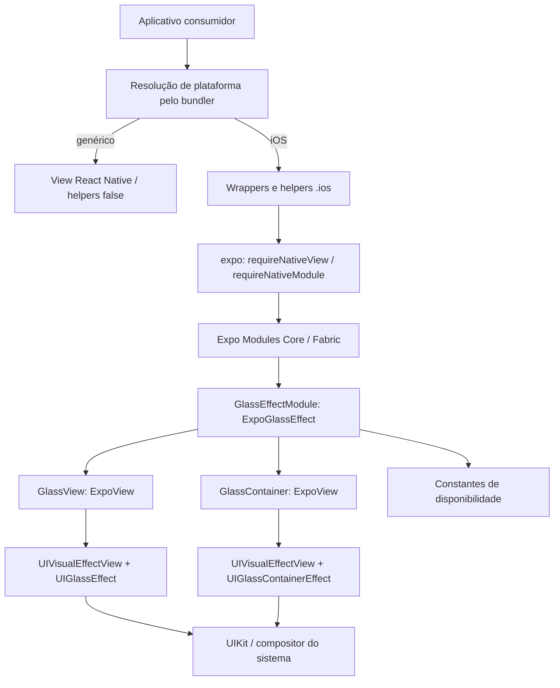

# Engenharia reversa de expo-glass-effect para iOS

**Versão examinada: 58.0.5. Investigação: 4 de novembro de 2026. Idioma: português do Brasil.**

O pacote oferece dois componentes React Native, `GlassView` e `GlassContainer`, e duas funções de detecção. A implementação visual pertence ao UIKit: `UIGlassEffect`, `UIGlassContainerEffect` e `UIVisualEffectView`. O código Expo adapta props, organiza filhos e contorna problemas de montagem, opacidade e reciclagem. Não há shader, blur ou refração próprios no artefato examinado.

Esta investigação cobre a distribuição npm e as fontes correspondentes. **Não foi fornecido IPA, framework compilado ou aplicativo iOS em execução.** As afirmações sobre Swift descrevem o código distribuído e seus gates; não constituem observações de pixels, gestos ou desempenho em dispositivo.

## Sumário

1. [Escopo e versão examinada](#scope)
2. [Como compilar, executar, configurar e usar](#build-use)
3. [Arquitetura e mapa dos artefatos](#architecture)
4. [Inventário de funcionalidades e cobertura](#inventory)
5. [Walkthroughs por funcionalidade](#features)
   - [Componentes, material e composição — F01–F08](#components)
   - [Ciclo de vida e recuperação — F09–F11](#lifecycle)
   - [Disponibilidade e fallback — F12–F14](#availability)
   - [Integração, exemplos e limites — F15–F20](#integration)
6. [Modelo de dados, armazenamento e migrações](#data)
7. [Interfaces públicas e contratos de integração](#contracts)
8. [Algoritmos, renderização e desempenho](#algorithms)
9. [Build, empacotamento, distribuição e atualizações](#packaging)
10. [Falhas e recuperação](#failures)
11. [Índice de evidências, verificações reproduzíveis e questões abertas](#evidence)

<a id="scope"></a>
## 1. Escopo e versão examinada

### 1.1 Identidade do alvo

O workspace estava vazio e não continha `AGENTS.md` aplicável, repositório Git ou artefato fornecido. Sem versão indicada, o alvo foi fixado na versão resolvida pelo endpoint oficial npm `latest` durante a coleta. Isso caracteriza este pacote específico; não identifica a versão instalada em um aplicativo desconhecido.

| Campo | Valor observado |
|---|---|
| Pacote | `expo-glass-effect@58.0.5`, licença MIT, 650 Industries |
| Tarball | [Distribuição oficial 58.0.5](https://registry.npmjs.org/expo-glass-effect/-/expo-glass-effect-58.0.5.tgz) |
| Cópia local | [artifacts/expo-glass-effect-58.0.5.tgz](../artifacts/expo-glass-effect-58.0.5.tgz) |
| Publicação npm | `2026-10-23T23:23:40.402Z` |
| SHA-256 do tarball | `c62fe880a26e761bc3fc6d259e6ab268e293f7344aaaa002389a804a5ec438ee` |
| SHA-1 informado e recalculado | `dfc73c5c2b580dfb2656194184cced9d7b044228` |
| Integridade SHA-512 | `sha512-PkL1X/r0cTs6NG47Xp3TxRvtqSeRmPYhPOHp3GDmZB2oOxpjXge6qLi/bSSv0asFWqf+MLOlXZ+hq2Imuh0Z1g==` |
| Repositório | [expo/expo no commit examinado](https://github.com/expo/expo/tree/a6078233c87546c50d56c8bc85f75253a78daed7/packages/expo-glass-effect) |
| Commit declarado pela proveniência npm | `a6078233c87546c50d56c8bc85f75253a78daed7` |
| Formato e build | Pacote npm: JS ESM emitido, declarações TypeScript, mapas e fontes TS/Swift; sem build nativo Debug/Release, IPA ou XCFramework |
| Plataforma principal | iOS; podspec também declara tvOS. Mínimo de integração 16.4; material exige OS 26 e compilador compatível |
| Ambiente da investigação | Windows, PowerShell, Node `v24.18.1`, Python 3.14; sem Xcode/simulador iOS |

Metadados preservados em [npm-release.json](evidence/npm-release.json) e [provenance-npm-time.json](evidence/provenance-npm-time.json). SHA-512 e SHA-1 foram conferidos pelo [replay reproduzível](evidence/check-shipped.mjs).

### 1.2 Distribuição versus repositório

O registro não forneceu `gitHead`. O payload SLSA da [attestation npm](https://registry.npmjs.org/-/npm/v1/attestations/expo-glass-effect@58.0.5) aponta para o commit acima e o workflow `.github/workflows/publish-packages.yml`; seu sujeito tem o mesmo SHA-512 do tarball. A cadeia criptográfica Sigstore/Rekor e as assinaturas npm não foram validadas. O vínculo é sustentado pelo conteúdo da attestation e pela comparação independente dos arquivos. Ver [payloads decodificados](evidence/provenance-payloads.json).

| Comparação com a pasta do pacote no commit | Resultado |
|---|---|
| Arquivos no Git | 28, árvore integral desse pacote |
| Arquivos no npm | 55; tamanho descompactado informado de 48.867 bytes |
| Compartilhados | 21; 20 idênticos byte a byte |
| Única diferença compartilhada | `package.json`: `@expo/internal-scripts` de `workspace:*` para `58.0.4`, remoção de `prepublishOnly` e ordenação de scripts |
| Apenas no Git | 7: `.npmignore`, `oxlint.config.mjs`, `tsconfig.json`, dois testes e dois snapshots |
| Adicionais no npm | 33 arquivos `build/*` e `LICENSE`, este idêntico à licença da raiz do monorepo |

As fontes produtivas `src/*`, os cinco arquivos `ios/*`, configs, README e changelog compartilhados coincidem. Os JS emitidos foram lidos e exercitados em replay; não foi refeita uma compilação para provar reprodução byte a byte de `build/*`. Os mapas examinados referenciam nomes TS/TSX e não embutem seu conteúdo (`sourcesContent: [null]`); as fontes reais estão em `src/`. Evidência: [comparação completa](evidence/provenance-comparison.json), [manifesto de fontes](evidence/provenance-source-manifest.json).

### 1.3 Tipos e limites das evidências

- **D — distribuição:** bytes do npm em [artifacts/package](../artifacts/package).
- **S — fonte:** código lido diretamente, inclusive dependências selecionadas no mesmo commit.
- **R — replay controlado:** execução dos JS publicados com mocks de `expo`, `react-native` e `react/jsx-runtime`. Não monta React, executa Metro/Fabric ou simula UIKit.
- **A — contrato externo:** documentação pública Apple/Expo, identificada por URL. Internos UIKit não foram inspecionados.
- **I — inferência:** consequência plausível do código, rotulada sem apresentá-la como bug reproduzido.

REA `6.7.0` foi usado efetivamente para analisar a árvore publicada, inspecionar módulos e rastrear importações. Reconheceu 33 arquivos JS/TS/declarations, sem falha de parse, mas manteve 86 desconhecidos semânticos. Cobertura de inventário marcada como completa pelo REA **não significa cobertura Swift nem execução do produto**. Os detalhes e IDs estão em [11.1](#rea-ledger).

Não houve descompilação nativa: não há Mach-O fornecido, e as ferramentas Apple de REA reportaram `unsupported_host` neste Windows. Não foi necessário configurar provedores ou instalar ferramentas. Nenhuma fonte do alvo foi alterada.

<a id="build-use"></a>
## 2. Como compilar, executar, configurar e usar

### 2.1 Integrar em um aplicativo

O alvo é uma biblioteca, sem aplicativo, servidor ou CLI de produto. Em um projeto Expo compatível, o comando documentado é `npx expo install expo-glass-effect`; para fixar a versão investigada, use `npx expo install expo-glass-effect@58.0.5` e confira a compatibilidade com o SDK do aplicativo. Os peers são `expo`, `react` e `react-native`, todos com faixa `*`; essa faixa não prova compatibilidade com todas as versões.

Em React Native sem configuração Expo, configure primeiro o pacote `expo`. No fluxo CocoaPods de um projeto nativo existente, o README orienta `npx pod-install`. Para executar um app Expo no iOS, use o fluxo do app, por exemplo `npx expo run:ios` em macOS com Xcode. Esses comandos não foram executados. Fontes: [README](../artifacts/package/README.md), linhas 14–31; [package.json](../artifacts/package/package.json), linhas 37–61; [documentação oficial](https://docs.expo.dev/versions/latest/sdk/glass-effect/).

| Condição | Consequência no código desta release |
|---|---|
| iOS/tvOS 16.4–25.x | Integração declarada possível; blocos de material 26 não são executados |
| Swift anterior a 6.2 | Referências aos novos tipos são excluídas por `#if compiler(>=6.2)` |
| Swift 6.2+, OS 26+ e APIs presentes | Caminho de material elegível; aparência final é do UIKit |
| Classe UIGlassEffect ou método effectWithStyle: ausente | GlassView evita o construtor e não instala material |
| API do container ausente | GlassContainer não cria seu efeito |
| Android/web | Módulos genéricos produzem View; helpers retornam false |

Os comentários associam Swift 6.2 a Xcode 26. O mínimo de integração 16.4 não torna Liquid Glass disponível nesse sistema. Cláusulas `macOS` em `#available` não comprovam suporte AppKit/macOS: o pacote importa UIKit e seu podspec só declara iOS/tvOS; o config SPM declara iOS. Fontes: [módulo](../artifacts/package/ios/GlassEffectModule.swift), [view](../artifacts/package/ios/GlassView.swift), [podspec](../artifacts/package/ios/ExpoGlassEffect.podspec), [SPM](../artifacts/package/spm.config.json).

### 2.2 Consumo

```tsx
import { Text, View } from 'react-native';
import {
  GlassContainer, GlassView,
  isGlassEffectAPIAvailable, isLiquidGlassAvailable,
} from 'expo-glass-effect';

export default function Example() {
  const apiAvailable = isGlassEffectAPIAvailable();
  const designAvailable = isLiquidGlassAvailable();
  return (
    <View style={{ padding: 24, backgroundColor: '#5277a8' }}>
      <Text>{`API: ${apiAvailable}; design: ${designAvailable}`}</Text>
      <GlassContainer spacing={16} style={{ flexDirection: 'row', gap: 8 }}>
        <GlassView
          glassEffectStyle="regular"
          tintColor="rgba(255,255,255,0.15)"
          colorScheme="auto"
          isInteractive
          style={{ width: 120, height: 80, borderRadius: 20 }}>
          <Text>Ação</Text>
        </GlassView>
        <GlassView glassEffectStyle="clear"
          style={{ width: 80, height: 80, borderRadius: 40 }} />
      </GlassContainer>
    </View>
  );
}
```

Exemplo derivado das interfaces, sem validação visual. `spacing` explícito evita o caso inicial `nil` de [F08](#f08). `gap` posiciona caixas; `spacing` controla a interação do material. Uma imagem atrás pode tornar o efeito perceptível, mas não é requisito ou recurso de rede da biblioteca. `isInteractive` não implementa ação de botão: use mecanismos de interação/acessibilidade do React Native.

Para mostrar/esconder apenas o material, mantendo os filhos:

```tsx
<GlassView glassEffectStyle={{
  style: visible ? 'regular' : 'none',
  animate: true,
  animationDuration: 0.5, // segundos
}} style={{ width: 160, height: 80, borderRadius: 16 }} />
```

### 2.3 Desenvolver o pacote

`upstream/` é um checkout seletivo de evidência, sem dependências instaladas. Para trabalhar nas fontes, obtenha o monorepo completo no commit indicado, prepare-o conforme suas instruções e use os scripts declarados:

```sh
pnpm --filter expo-glass-effect build
pnpm --filter expo-glass-effect typecheck
pnpm --filter expo-glass-effect test
pnpm --filter expo-glass-effect lint
pnpm --dir apps/native-component-list ios
```

A raiz declara pnpm `12.2.1` e Node `^22.13.0 || ^24.3.0 || ^26.0.0 || >=27.0.0`. Build chama `expo-build src`; typecheck usa `tsc -p tsconfig.json`; test chama Jest com preset `@expo/internal-scripts`. Não foi instalado o monorepo, executado Jest ou compilado o demo. O último comando requer preparação nativa e macOS; é o script declarado, não uma verificação local. Fontes: [raiz upstream](../upstream/package.json), [scripts do pacote](../upstream/packages/expo-glass-effect/package.json), [app](../upstream/apps/native-component-list/package.json).

<a id="architecture"></a>
## 3. Arquitetura e mapa dos artefatos



O ramo iOS é escolhido por arquivo `.ios`, não por teste de versão de OS no wrapper. Em iOS antigo ainda se solicita a view nativa; o Swift decide não instalar material. As funções de disponibilidade são independentes: as views não chamam os helpers JS para decidir montagem.

| Caminho a partir deste workspace | Papel |
|---|---|
| `artifacts/package/package.json` | Identidade, exports, peers e scripts |
| `artifacts/package/src/index.ts` | Quatro exports de runtime e cinco de tipos |
| `artifacts/package/src/*.ios.ts[x]` | Views nativas e leitura/cache de constantes |
| `artifacts/package/src/*` genéricos | Fallback View, helpers false e contratos |
| `artifacts/package/build/` | 11 JS, 11 declarations e 11 mapas publicados |
| `artifacts/package/ios/GlassEffectModule.swift` | Registro, duas constantes, duas views e setters |
| `artifacts/package/ios/GlassStyle.swift` | Enums e Record de animação |
| `artifacts/package/ios/GlassView.swift` | Material, cantos, filhos e recuperação |
| `artifacts/package/ios/GlassContainer.swift` | Composição, spacing e filhos |
| `artifacts/package/ios/ExpoGlassEffect.podspec` | CocoaPods e framework estático |
| `artifacts/package/expo-module.config.json` | Autolinking Apple de GlassEffectModule |
| `artifacts/package/spm.config.json` | Config para gerador SPM do monorepo |
| `upstream/packages/expo-glass-effect/` | Árvore Git completa do pacote, incluindo testes |
| `upstream/packages/expo-modules-core/` | Trechos selecionados da ponte JS/Fabric |
| `upstream/apps/native-component-list/` | Demo, registro e navegação selecionados |
| `upstream/docs/pages/versions/v58.0.0/sdk/glass-effect.mdx` | Documentação fixada no commit |
| `docs/evidence/` | Metadados, hashes, evidência REA, notas e checks |

`expo` reexporta `requireNativeViewManager` como `requireNativeView`: [Expo.ts](../upstream/packages/expo/src/Expo.ts), linha 20. O adaptador usa `NativeComponentRegistry`, cache por módulo/view e configuração nativa; os nomes seguem `ViewManagerAdapter_ExpoGlassEffect_GlassView` e `..._GlassContainer`, com possível sufixo do identificador do app. Esse identificador participa do nome registrado, não da chave desse cache. Ver [adaptador](../upstream/packages/expo-modules-core/src/NativeViewManagerAdapter.native.tsx), linhas 49–77 e 118–131. Esses trechos são do commit correspondente, não de dependências identificadas em um IPA.

No Apple, `ExpoView` é alias de `ExpoFabricView`. O Fabric converte props e chama os setters registrados; a implementação Swift do core é `@MainActor` e usa `try? prop.set(...)`. Falhas de conversão nesse trecho não são propagadas como exceção JS pelo componente. O alvo não contém parser próprio. Fontes: [alias](../upstream/packages/expo-modules-core/ios/Core/Views/ExpoView.swift), [ExpoFabricView.swift](../upstream/packages/expo-modules-core/ios/Fabric/ExpoFabricView.swift), linhas 83–102, [ExpoFabricViewObjC.mm](../upstream/packages/expo-modules-core/ios/Fabric/ExpoFabricViewObjC.mm), linhas 199–217.

<a id="inventory"></a>
## 4. Inventário de funcionalidades e cobertura

Inventário cruzado com os 55 arquivos publicados, árvore integral do pacote no Git, exports/types, registros nativos, configs, seis casos de teste e exemplos selecionados. Não apareceram contas, roles, rotas HTTP, CLI de produto, atalhos de teclado, jobs, banco ou migrações nesse escopo. A rota de demo pertence ao app `native-component-list`, não ao SDK. Dependências e o restante do monorepo não foram inventariados integralmente.

**Status:** verificado significa que a afirmação delimitada da linha é sustentada por artefato/fonte e replay quando aplicável; parcialmente verificado indica caminho conhecido com build/ponte/OS não executado; inferido seria um recurso cuja existência depende de inferência; não verificado indica implementação inacessível. Hipóteses de bugs não são funcionalidades adicionais. Nenhum status implica execução em iOS.

| ID | Funcionalidade | Status | Evidência / alcance | Lacuna |
|---|---|---|---|---|
| [F01](#f01) | GlassView e filhos | Parcialmente verificado | D/S/R: wrapper e hierarquia | Montagem/pixels UIKit |
| [F02](#f02) | regular, clear, none | Parcialmente verificado | D/S: enum e atribuição | Aparência real |
| [F03](#f03) | Animação de estilo | Parcialmente verificado | D/S/R: forwarding e UIView.animate | Temporização nativa |
| [F04](#f04) | Tint e cores dinâmicas | Parcialmente verificado | D/S: ColorValue → UIColor → efeito | Conversão e pixels |
| [F05](#f05) | Interatividade | Parcialmente verificado | D/S: limpeza e flag UIKit | Toque/foco real |
| [F06](#f06) | auto/light/dark | Parcialmente verificado | D/S: override da aparência | Tema no device |
| [F07](#f07) | Cantos, RTL e curva | Parcialmente verificado | D/S: precedência e configuração | Geometria/ponte real |
| [F08](#f08) | Container, fusão e spacing | Parcialmente verificado | D/S/A: composição e filhos | Fusão e spacing omitido |
| [F09](#f09) | Layout e remontagem | Parcialmente verificado | D/S: hooks e isMounted | Navegação real |
| [F10](#f10) | Instalação após fade | Parcialmente verificado | D/S: limiar e display link | Hardware real |
| [F11](#f11) | Recuperação de reciclagem | Parcialmente verificado | D/S: hook e changelog | Regressão reproduzida |
| [F12](#f12) | isLiquidGlassAvailable | Parcialmente verificado | D/S/R: lógica e cache JS | SDK/OS/Info.plist reais |
| [F13](#f13) | isGlassEffectAPIAvailable | Parcialmente verificado | D/S/R: lookup, cache e erros | Classes/selectors reais |
| [F14](#f14) | Fallback genérico | Verificado | D/S/R: View, props e false | RN web/Android real |
| [F15](#f15) | ViewProps, ref e acessibilidade comum | Parcialmente verificado | D/S/R: tipos, forwarding e ponte | Instância/VoiceOver |
| [F16](#f16) | Exports e resolução | Verificado | D/S: manifests e distribuição | Resolver Metro/tvOS |
| [F17](#f17) | Autolinking, Pods e SPM | Parcialmente verificado | D/S: configuração | Compilação/link Apple |
| [F18](#f18) | Testes e controles do demo | Verificado | S: existência, registro e uso | Demo/Jest não executados |
| [F19](#f19) | Preferências/compatibilidade | Parcialmente verificado | S/A: limites e delegação | Ajustes reais do OS |
| [F20](#f20) | Internos do renderizador Apple | Não verificado | D/S/A: fronteira pública | Shader, GPU e fusão |

**Contagem reconciliada: 20 IDs; 3 verificados, 16 parcialmente verificados, 0 inferidos e 1 não verificado.** Todos têm seção própria. A cobertura de fontes produtivas do pacote é integral; a execução nativa não foi realizada.

<a id="features"></a>
## 5. Walkthroughs por funcionalidade
<a id="components"></a>
### Componentes, material e composição

Os recursos F01–F11 estão **parcialmente verificados**: os caminhos abaixo existem no Swift distribuído em 58.0.5 e foram lidos diretamente, mas nenhum efeito UIKit foi observado em execução. A disponibilidade nativa combina `#if compiler(>=6.2)`, sistema >=26 e consultas dinâmicas de classe; o detalhe dos helpers públicos está em F12–F13. Não se deve interpretar uma instância criada, uma atribuição de propriedade ou `isMounted=true` como evidência de pixels renderizados.

<a id="f01"></a>
#### F01 — GlassView, conteúdo e hierarquia nativa

**Uso.** Importe `GlassView` e forneça dimensões/estilos de `View`; coloque conteúdo React como `children`. Um fundo visual atrás da superfície permite perceber o material. O componente não fornece botão, texto ou imagem próprios.

```tsx
<GlassView style={{ width: 180, height: 80, borderRadius: 20 }}>
  <Text>Conteúdo da superfície</Text>
</GlassView>
```

**Caminho.** O export aponta para `GlassView`; no caminho iOS, `requireNativeView('ExpoGlassEffect', 'GlassView')` resolve a view Expo e o wrapper encaminha todas as props. `View(GlassView.self)` registra a classe Swift. Seu construtor cria uma `UIVisualEffectView`, configura autoresizing flexível nas duas dimensões e a adiciona ao `ExpoView`. Os callbacks de montagem inserem filhos na `contentView` dessa view interna, preservando o índice recebido; desmontagem chama `removeFromSuperview()`.

```text
GlassView React → view Expo → GlassView: ExpoView
                              └─ UIVisualEffectView
                                  └─ contentView → filhos React Native
```

**Limites e ownership.** O pacote decide a hierarquia e as props. Layout, conversão e refs dependem de React Native/ExpoModulesCore; o material e sua composição pertencem ao UIKit. Não há framebuffer, shader ou blur próprio. No caminho iOS, um SO antigo ainda usa essa classe nativa, cujo efeito fica sem a API nova; não existe troca por `<View>` baseada na versão do SO dentro do wrapper iOS. Sem runtime, clipping e geometria final dos filhos permanecem pendentes.

As alterações de propriedades convergem no mesmo método de reaplicação, que não lança um evento de sucesso:

```text
updateEffect():
  se !isMounted: retornar
  se API ausente: retornar
  se glassEffect é UIGlassEffect:
    aplicar glassTintColor
    aplicar glassIsInteractive ou false
    aplicar esquema, quando guardado
    glassEffectView.effect = glassEffect
    atualizar cantos
    copiar curva da camada externa
```

A reatribuição final do mesmo objeto é intencional: o comentário em `updateEffect` registra que apenas modificar suas propriedades não aplica a mudança.

**Evidências.** [`src/GlassView.ios.tsx`, L9–15](../artifacts/package/src/GlassView.ios.tsx#L9), [`GlassEffectModule.definition`, L40](../artifacts/package/ios/GlassEffectModule.swift#L40), [`GlassView.init`, L31–37](../artifacts/package/ios/GlassView.swift#L31), [`mountChildComponentView`/`unmountChildComponentView`, L341–347](../artifacts/package/ios/GlassView.swift#L341).

<a id="f02"></a>
#### F02 — Estilos regular, clear e none

**Uso.** Defina `glassEffectStyle="regular"`, `"clear"` ou `"none"`. O contrato público declara `regular` como default. `none` desativa a decoração de vidro e mantém a view e os filhos; não equivale a ocultar ou desmontar o componente.

**Caminho.** A prop chega como `Either<GlassStyle, GlassEffectStyleConfig>?`. O módulo tenta obter uma configuração, depois um enum; na ausência de ambos chama `setGlassStyle(.regular)`. Os dois overloads de setter convergem em `applyGlassStyle`. Quando o enum muda, o método atualiza o cache `glassStyle`, verifica disponibilidade e executa uma closure de aplicação.

Para `clear`/`regular`, `toUIGlassEffectStyle()` produz o estilo UIKit e a closure cria um novo `UIGlassEffect`, armazena-o em `glassEffect` e chama `updateEffect()`. Para `none`, a conversão retorna `nil`, mas o código atribui `UIVisualEffect()` à view e ao cache. O comentário explica que atribuir `nil` não removia o efeito como esperado.

**Estado e erros.** `updateEffect()` só atribui `UIGlassEffect` quando a view está montada. Configurações recebidas antes disso ficam em memória até a instalação. O cache do enum muda antes do gate de API: em ambiente incompatível, a intenção fica guardada, mas o código retorna sem construir o material novo. Valores fora dos enums dependem do decoder Expo; não há normalização de strings ou tratamento próprio de exceções no wrapper.

**Ownership e limite.** O pacote escolhe objetos e os reatribui à view; o UIKit determina aparência, refração e adaptação ao fundo. Não foi confirmada a diferença visual entre `clear` e `regular`, nem a equivalência visual de `none` entre versões do SO.

**Evidências.** [`GlassViewProps`, L24–31](../artifacts/package/src/GlassView.types.ts#L24), [`Prop("glassEffectStyle")`, L41–48](../artifacts/package/ios/GlassEffectModule.swift#L41), [`GlassStyle.toUIGlassEffectStyle`, L4–21](../artifacts/package/ios/GlassStyle.swift#L4), [`applyGlassStyle`, L170–202](../artifacts/package/ios/GlassView.swift#L170), [`updateEffect`, L318–340](../artifacts/package/ios/GlassView.swift#L318).

<a id="f03"></a>
#### F03 — Transições animadas de estilo

**Uso.** Troque o estilo por estado React e passe a configuração abaixo. A duração está em **segundos**; omitindo-a, o pacote usa o overload de animação sem duração explícita.

```tsx
glassEffectStyle={{
  style: visible ? 'regular' : 'none',
  animate: true,
  animationDuration: 0.5,
}}
```

**Caminho.** `GlassEffectStyleConfig` tem `style`, `animate` e duração opcional. O `Record` Swift define defaults `.regular`, `false` e ausência de duração; o TypeScript exige `style`. `setGlassStyle(config)` envia esses campos a `applyGlassStyle`. Para `animate=true`, a mesma closure de F02 roda em `UIView.animate(withDuration:animations:)` se há duração, ou em `UIView.animate(animations:)` caso contrário. Sem animação, a closure roda diretamente.

**Estado e limites.** A condição de mudança compara somente o enum do estilo. Alterar apenas `animate` ou duração, mantendo `regular`, por exemplo, não dispara nova aplicação. Não há callback de término, cancelamento, curva própria ou atualização JavaScript por frame. Não há clamp explícito de duração negativa, infinita ou NaN; a conversão Expo e o UIKit são fronteiras externas a esse código. Animações sobrepostas seguem o comportamento desses overloads UIKit.

**Ownership.** React inicia a troca; o pacote seleciona o caminho animado; UIKit interpola a transição. Uma configuração animada recebida antes da montagem pode criar o objeto antes de `updateEffect()` poder atribuí-lo; uma primeira animação visível não foi demonstrada. Duração real e comportamento ao interromper transições exigem iOS em execução.

**Evidências.** [`GlassEffectStyleConfig` TS, L6–20](../artifacts/package/src/GlassView.types.ts#L6), [`GlassEffectStyleConfig` Swift, L24–33](../artifacts/package/ios/GlassStyle.swift#L24), [`setGlassStyle` e `applyGlassStyle`, L162–201](../artifacts/package/ios/GlassView.swift#L162).

<a id="f04"></a>
#### F04 — Tint e cores dinâmicas

**Uso.** Passe `tintColor` como um `ColorValue` React Native. A interface aceita as formas de cor suportadas por esse tipo, incluindo cores de plataforma e dinâmicas; a prop é opcional.

```tsx
<GlassView tintColor="rgba(40, 100, 220, 0.25)" style={surfaceStyle} />
```

**Caminho.** `Prop("tintColor")` recebe `UIColor?` da ponte Expo e chama `setTintColor`. O setter compara com `glassTintColor`, atualiza esse cache e chama `updateEffect()`. Havendo montagem e um `UIGlassEffect` válido, o método atribui `effect.tintColor = glassTintColor`, reaplica o objeto na `UIVisualEffectView` e atualiza cantos/curva.

**Estado e limites.** Antes de montar, o valor fica no cache. Em `none`, o cache ainda pode mudar, mas `updateEffect()` não aplica tint porque o efeito guardado é um `UIVisualEffect` vazio. Ao voltar para um estilo de vidro, o valor guardado é aplicado. `nil` retira o tint customizado. Não há parser RGB próprio, persistência ou observador de mudança de tema no pacote.

**Ownership.** A ponte Expo/React Native converte `ColorValue` em `UIColor`; UIKit resolve a cor e sua interação com o material. A aceitação efetiva de cada variante dinâmica e os pixels finais não foram exercitados. A mudança do tipo público para `ColorValue` em 58.0.0 não significa que o pacote tenha implementado um resolvedor de cores novo.

**Evidências.** [`tintColor?: ColorValue`, L32–35](../artifacts/package/src/GlassView.types.ts#L32), [`Prop("tintColor")`, L51–53](../artifacts/package/ios/GlassEffectModule.swift#L51), [`setTintColor`, L271–276](../artifacts/package/ios/GlassView.swift#L271), [`updateEffect`, L327–336](../artifacts/package/ios/GlassView.swift#L327), [`CHANGELOG`, L31–39](../artifacts/package/CHANGELOG.md#L31).

<a id="f05"></a>
#### F05 — Interatividade do material

**Uso.** Defina `isInteractive` para habilitar a resposta interativa do material UIKit. O default público é `false`. Para executar ações do aplicativo, associe componentes/eventos React Native, como `Pressable`; essa prop não fornece `onPress` próprio.

**Caminho.** A prop é convertida para `Bool` e entregue a `setInteractive`. Se mudou em relação a `glassIsInteractive`, o setter guarda o valor, substitui imediatamente o efeito anterior por `UIVisualEffect()` e chama `updateEffect()`. Na reaplicação, o pacote atribui `effect.isInteractive = glassIsInteractive ?? false` e reassocia o efeito à view.

**Por que limpar.** O comentário local exige limpar o efeito anterior para mudar interatividade depois da montagem. Esse passo é parte do contrato de implementação observado no código e deve ser preservado numa reprodução; apenas alterar a propriedade do objeto não reproduz a sequência completa.

**Limites e ownership.** Não há recognizer, física, hover, foco, haptic ou hit-test customizado no pacote. A resposta visual/tátil que o SO eventualmente produz pertence ao UIKit. O caminho também pode limpar o efeito antes da montagem, mas `updateEffect()` aguarda `isMounted`. Com estilo `none`, a limpeza mantém a decoração vazia. Nenhum toque, foco tvOS ou transição de interatividade foi observado neste host.

**Evidências.** [`isInteractive`, L36–40](../artifacts/package/src/GlassView.types.ts#L36), [`Prop("isInteractive")`, L55–57](../artifacts/package/ios/GlassEffectModule.swift#L55), [`setInteractive`, L278–285](../artifacts/package/ios/GlassView.swift#L278), [`updateEffect`, L327–334](../artifacts/package/ios/GlassView.swift#L327).

<a id="f06"></a>
#### F06 — Aparência auto, light e dark

**Uso.** Passe `colorScheme="auto"`, `"light"` ou `"dark"`, por exemplo para acompanhar o seletor de tema do aplicativo. O default registrado no módulo é `auto`.

**Caminho.** O decoder fornece `GlassColorScheme`; `setColorScheme` compara/cacheia e chama `updateEffect()`. O enum mapeia `auto` para `.unspecified`, `light` para `.light` e `dark` para `.dark`. Havendo `UIGlassEffect` montado, o resultado vai para `glassEffectView.overrideUserInterfaceStyle`, antes da reatribuição do efeito.

**Estado e limites.** `auto` deixa a aparência ser resolvida pela hierarquia/sistema. O pacote não muda o tema global do app nem o `overrideUserInterfaceStyle` do `ExpoView` externo. Como os filhos são montados no `contentView` interno, a herança de traits pode alcançá-los; o resultado por componente depende de UIKit/React Native e não foi observado. Mudar tema em `none` guarda o valor, mas sua aplicação explícita espera a próxima atualização com um `UIGlassEffect`.

**Ownership.** O pacote faz o mapeamento de três valores; o sistema resolve traits e a aparência do material. Não há storage de tema, escuta própria de preferências ou transformação de cores dos filhos. Props inválidas passam pelo tratamento padrão do decoder Expo, sem recuperação específica neste módulo.

**Evidências.** [`GlassColorScheme` e prop, L22–46](../artifacts/package/src/GlassView.types.ts#L22), [`Prop("colorScheme", .auto)`, L59–61](../artifacts/package/ios/GlassEffectModule.swift#L59), [`toUIUserInterfaceStyle`, L35–49](../artifacts/package/ios/GlassStyle.swift#L35), [`setColorScheme`, L287–292](../artifacts/package/ios/GlassView.swift#L287), [`updateEffect`, L330–334](../artifacts/package/ios/GlassView.swift#L330).

<a id="f07"></a>
#### F07 — Cantos individuais, RTL e borderCurve

**Uso.** Use `style` de `View` com `borderRadius`, raios físicos por canto ou raios lógicos `Start`/`End`. `borderCurve` acompanha a curva da camada externa. O pacote registra as props de raios nativas para sincronizar a superfície interna, além da geometria externa controlada pelo framework.

```tsx
style={{
  borderRadius: 12,
  borderTopStartRadius: 24,
  borderTopLeftRadius: 8,
}}
```

Nesse exemplo, o canto superior esquerdo resolve para `8` tanto em LTR quanto em RTL; o físico prevalece sobre o lógico e sobre o global.

**Caminho.** O módulo registra o raio global, quatro físicos e quatro lógicos. Cada setter armazena um `CGFloat?`, compara o valor anterior e chama `updateBorderRadius()`. Esse método verifica a API, consulta `RCTI18nUtil.sharedInstance()?.isRTL() ?? false` e resolve cada canto pela tabela abaixo. Valores físicos têm precedência sobre lógicos; `0` explícito também vence os fallbacks.

| Canto final | LTR | RTL |
|---|---|---|
| Superior esquerdo | `topLeft ?? topStart ?? global ?? 0` | `topLeft ?? topEnd ?? global ?? 0` |
| Superior direito | `topRight ?? topEnd ?? global ?? 0` | `topRight ?? topStart ?? global ?? 0` |
| Inferior esquerdo | `bottomLeft ?? bottomStart ?? global ?? 0` | `bottomLeft ?? bottomEnd ?? global ?? 0` |
| Inferior direito | `bottomRight ?? bottomEnd ?? global ?? 0` | `bottomRight ?? bottomStart ?? global ?? 0` |

Os quatro valores viram `UICornerRadius(floatLiteral:)`, usados em `glassEffectView.cornerConfiguration = .corners(...)`. O pacote não desenha uma máscara ou arredondamento por shader. `setBorderCurve(_: String?)` **ignora o argumento recebido** e copia `self.layer.cornerCurve` para a camada interna; depende de o framework aplicar o estilo à camada externa. `updateEffect()` repete a sincronização de raios e curva ao reaplicar material.

**Limites e ownership.** O cálculo local usa direção RTL global do React e não consulta `layoutDirection` por view nem política separada de troca esquerda/direita. Não há clamp próprio dos raios. A assinatura `CGFloat?` não estabelece suporte a strings percentuais, mesmo que outros estilos React Native possam aceitá-las. Uma mudança global de RTL sem nova prop/atualização não provoca recálculo por observador local; recriação da árvore pelo framework pode resolver isso, mas não foi testada.

**Evidências.** [`props de bordas`, L63–101](../artifacts/package/ios/GlassEffectModule.swift#L63), [`updateBorderRadius`, L122–160](../artifacts/package/ios/GlassView.swift#L122), [`setters de raios e curva`, L205–269](../artifacts/package/ios/GlassView.swift#L205), [`reaplicação`, L334–336](../artifacts/package/ios/GlassView.swift#L334).

<a id="f08"></a>
#### F08 — GlassContainer, fusão e spacing

**Uso.** Agrupe superfícies dentro de `GlassContainer`. `spacing` controla a distância de influência entre materiais; `gap`, margem e posições continuam sendo decisões de layout React Native. Não há fusão calculada pelo JavaScript.

```tsx
<GlassContainer spacing={12} style={{ flexDirection: 'row', gap: 8 }}>
  <GlassView style={{ width: 56, height: 56, borderRadius: 28 }} />
  <GlassView style={{ width: 56, height: 56, borderRadius: 28 }} />
</GlassContainer>
```

**Caminho.** `requireNativeView('ExpoGlassEffect', 'GlassContainer')` fornece a classe registrada no módulo. O construtor Swift instala uma `UIVisualEffectView` com autoresizing, inicialmente sem efeito. Filhos são montados em `containerEffectView.contentView`. A prop chama `setSpacing(CGFloat?)`; se o valor difere do cache, o método atualiza o cache, exige compilador/SO compatíveis e existência de `UIGlassContainerEffect`, cria novo efeito, define `effect.spacing` quando o argumento não é `nil` e atribui o efeito à view e ao cache `containerEffect`.

**Caso importante de inicialização.** O default público é `undefined`. O campo `containerSpacing` inicia `nil`, e não há construção do efeito no `init`. Se o primeiro argumento de `setSpacing` também for `nil`, a comparação `containerSpacing != spacing` é falsa e **esse caminho não constrói `UIGlassContainerEffect`**. Isso é confirmado pelo fluxo estático; a conclusão de que a fusão ficará visualmente ausente ainda é uma hipótese, pois a ponte e os pixels não foram observados. Um número explícito, como no exemplo, toma o ramo que constrói o efeito. Depois de um número para `nil`, o valor muda e o efeito novo usa o default UIKit.

**Limites e ownership.** Cada mudança aceita cria novo objeto; não há animação própria, normalização, clamp ou medição de distâncias. O gate do container testa a classe, sem o selector `effectWithStyle:` usado para `UIGlassEffect`. O helper público de API verifica apenas esta última classe e não prova a disponibilidade independente do container. O UIKit executa fusão/composição; o pacote fornece a hierarquia e `spacing`. O container não possui o monitor de alpha e os callbacks de recuperação específicos da `GlassView`; essa diferença de código não prova falha.

**Evidências.** [`GlassContainerProps`, L4–12](../artifacts/package/src/GlassContainer.types.ts#L4), [`wrapper`, L9–14](../artifacts/package/src/GlassContainer.ios.tsx#L9), [`registro`, L104–108](../artifacts/package/ios/GlassEffectModule.swift#L104), [`GlassContainer` completo, L5–55](../artifacts/package/ios/GlassContainer.swift#L5).

<a id="lifecycle"></a>
### Ciclo de vida e recuperação

O estado de montagem controla **quando atribuir** o efeito UIKit e quando tentar novamente. Não há banco, evento de sucesso visual, verificação de framebuffer ou contador de frames renderizados. Props permanecem nos campos da instância durante saídas e reentradas na janela.

<a id="f09"></a>
#### F09 — Layout, janela e remontagem

**Uso.** É automático ao inserir, navegar, remover ou reapresentar a view; não há método público `mount()`/`refresh()`. O app fornece layout e props normalmente. Reentrada com a mesma geometria é tratada explicitamente.

**Caminho.** `didMoveToWindow()` chama `setNeedsLayout()` quando há janela. `layoutSubviews()` chama `super`, retorna se `isMounted` ou se a API está ausente, e decide entre instalar e aguardar visibilidade. `installEffect()` marca `isMounted=true`, invalida a espera, atribui um `UIVisualEffect()` vazio para limpar estado anterior e chama `updateEffect()`.

```text
didMoveToWindow:
  se saiu da janela: isMounted = false; parar espera
  senão: solicitar layout
layoutSubviews:
  super.layoutSubviews()
  se isMounted ou API ausente: retornar
  se renderizável: isMounted = true; parar espera; limpar; updateEffect()
  senão: iniciar espera, se ainda não existir
```

**Precisão importante.** Os comentários dizem que o efeito precisa ser criado no layout. A instalação inicial e a reinstalação após reentrada passam pelo layout; setters também reaplicam diretamente quando a view já está montada. `UIGlassEffect(style:)` pode ser construído antes do layout, dentro do setter de estilo. Não se deve descrever esse código como se todo construtor ou reaplicação só pudesse rodar em `layoutSubviews`. `isMounted` apenas registra que `installEffect()` foi executado: sem um `UIGlassEffect` guardado, `updateEffect()` não atribui material novo.

**Ownership e limites.** Expo/React Native e UIKit disparam os callbacks; o pacote agenda layout e preserva caches para reentrada. Não há retry temporizado para API ausente, mensagem de erro ou fallback de carregamento do módulo. Navegação real, ordem de entrega inicial das props e efeito após reentrada dependem do runtime e não foram observados.

**Evidências.** [`layoutSubviews`, L54–64](../artifacts/package/ios/GlassView.swift#L54), [`installEffect`, L87–95](../artifacts/package/ios/GlassView.swift#L87), [`construção no setter`, L178–181](../artifacts/package/ios/GlassView.swift#L178), [`didMoveToWindow`, L303–316](../artifacts/package/ios/GlassView.swift#L303), [`updateEffect`, L318–340](../artifacts/package/ios/GlassView.swift#L318).

<a id="f10"></a>
#### F10 — Instalação após fade, alpha baixo e hidden

**Uso.** O mecanismo é automático quando a view entra na janela oculta ou com opacidade baixa e depois aparece. O aplicativo não configura o limiar. Para transições de material, F03 evita depender de animação de opacidade do vidro.

**Caminho.** `isEffectRenderable` exige `window != nil`. Percorre `self` e todos os ancestrais; qualquer `isHidden` retorna `false`. Multiplica os `alpha` da cadeia e exige produto **estritamente maior que `0.02`**. Logo `0.02` exato continua sem instalação. O código não exige dimensões maiores que zero nem examina oclusão por outra view.

Se a condição falha no layout, `waitForVisibility()` cria no máximo um `CADisplayLink`, adicionado ao run loop principal em modo `.common`. A cada tick, se renderizável, `onVisibilityTick()` chama `setNeedsLayout()`. A aplicação ocorre no layout subsequente, não diretamente no callback do display link. `WeakDisplayLinkProxy` guarda a view com referência fraca, evitando ciclo de retenção. Instalação, saída da janela e `deinit` invalidam o link.

**Calibração e custo.** O comentário diz que `0.02` foi escolhido por tentativa em hardware e deve ser retestado em vários dispositivos se mudar. É heurística do pacote, não garantia da API Apple. A checagem custa uma caminhada pelos ancestrais a cada tick enquanto espera; views anexadas e permanentemente ocultas podem continuar aguardando sem timeout ou backoff. Não há medição de FPS, GPU, consumo ou limite próprio de taxa.

**Limites e ownership.** Após a primeira instalação, o link para e `layoutSubviews()` retorna por `isMounted`; o pacote não monitora continuamente fades posteriores sem sair da janela. Setters podem chamar `updateEffect()` enquanto a view montada tem alpha baixo, pois esse método não repete o teste de visibilidade. A recuperação nesses cenários depende de UIKit e requer teste real. O pacote controla a espera; o SO controla quando o material se torna renderizável e seus pixels.

**Evidências.** [`isEffectRenderable`, L66–85](../artifacts/package/ios/GlassView.swift#L66), [`display link e invalidação`, L97–120](../artifacts/package/ios/GlassView.swift#L97), [`WeakDisplayLinkProxy`, L350–361](../artifacts/package/ios/GlassView.swift#L350), [`CHANGELOG 58.0.2`, L21–25](../artifacts/package/CHANGELOG.md#L21).

<a id="f11"></a>
#### F11 — Limpeza antes da reciclagem do pai, correção 58.0.5

**Uso.** Recuperação automática em navegação/reciclagem de views. A release 58.0.5 descreve o caso de um vidro anterior cujo pai é reaproveitado como conteúdo de um novo vidro, que depois aparece por fade. Não há configuração para habilitar a correção.

**Caminho.** Antes de sair da janela, `willMove(toWindow: nil)` chama `super` e atribui `UIVisualEffect()` à view interna. O comentário informa que remover vidro com efeito vivo deixava estado no superview capaz de impedir um vidro posterior. Após sair, `didMoveToWindow()` reseta `isMounted` e invalida o display link. Na reentrada, solicita layout; quando visível, `installEffect()` limpa novamente a atribuição anterior e reaplica o material a partir dos caches.

**Separação de responsabilidades.** O pacote executa a limpeza antes da remoção e a reinstalação. A reciclagem da árvore é de React Native/Expo, e o estado interno que o UIKit mantém sobre composição não foi inspecionado. A descrição do problema vem do changelog e dos comentários da release, corroborada pela presença desses callbacks; não é um diagnóstico reproduzido neste ambiente.

**Limites e preservação.** A limpeza não apaga o conteúdo React, o estilo escolhido, tint, interação, esquema ou raios da instância. Não há chamada a cache global, flush gráfico ou API privada. A atribuição vazia é deliberada; substituí-la por `nil`, omiti-la ou movê-la para depois da remoção altera a sequência documentada. O container não implementa o mesmo callback específico.

**Evidências.** [`willMove(toWindow:)`, L294–301](../artifacts/package/ios/GlassView.swift#L294), [`didMoveToWindow`, L303–316](../artifacts/package/ios/GlassView.swift#L303), [`installEffect`, L87–95](../artifacts/package/ios/GlassView.swift#L87), [`CHANGELOG 58.0.5`, L3–7](../artifacts/package/CHANGELOG.md#L3).

**Lacuna de confirmação.** É necessário um app iOS compilado com esta release, navegação/reciclagem sintética e captura antes/depois para confirmar o efeito visível dessa correção e diferenciá-lo do gate de opacidade de F10. Nenhuma execução UIKit foi realizada.

<a id="availability"></a>
### Disponibilidade e fallback

<a id="f12"></a>
#### F12 — isLiquidGlassAvailable: design do aplicativo

**Uso.** Chame `isLiquidGlassAvailable(): boolean` para consultar a disponibilidade declarada do design no aplicativo compilado. É síncrona, sem parâmetros ou Promise. Não mede se uma view desenhou, se o usuário reduziu transparência ou se a classe runtime está íntegra.

O JS iOS só chama `requireNativeModule` no primeiro acesso. Lê a **propriedade constante**, não um método nativo, `ExpoGlassEffect.isLiquidGlassAvailable`. Guarda o resultado em variável de módulo e retorna `!!valor`. `false` fica em cache; `undefined` provoca nova consulta na chamada seguinte; não há invalidação por mudança de ajustes. Erros propagam e a chamada seguinte tenta novamente. Esses casos foram executados no JS publicado com mocks. Fontes: [source](../artifacts/package/src/isLiquidGlassAvailable.ios.ts), linhas 3–20; [JS publicado](../artifacts/package/build/isLiquidGlassAvailable.ios.js); [resultados](evidence/check-shipped-results.json).

A constante Swift segue esta árvore em [GlassEffectModule.swift](../artifacts/package/ios/GlassEffectModule.swift), linhas 9–25 e 112–125:

```text
se compilador < 6.2: false
senão, se OS < 26: false
senão, se OS >= 27 E major(DTPlatformVersion) >= 27: true
senão, se UIDesignRequiresCompatibility é Bool: !valor
senão: true
```

`buildSDKMajorVersion` lê `Bundle.main.infoDictionary['DTPlatformVersion']`, extrai o prefixo numérico e retorna 0 se faltar/falhar. SDK e compilador são versões distintas; o comentário cita Xcode 26.6 com Swift 6.3 como motivo para ler metadados em runtime.

`UIDesignRequiresCompatibility=true` faz a constante retornar false no caminho antigo, mas **não bloqueia diretamente os construtores das views**. F13 é outro teste; F12 pode retornar true sem testar classe/selector. A [Apple documenta a chave de compatibilidade](https://developer.apple.com/documentation/bundleresources/information-property-list/uidesignrequirescompatibility) e informa que builds SDK 27 a ignoram. Esta release exige SDK **e runtime** >=27 para a exceção; SDK 27 executando em OS 26 é uma questão a testar, não resultado observado.

<a id="f13"></a>
#### F13 — isGlassEffectAPIAvailable: API runtime

**Uso.** Consulte antes de depender da API visual, especialmente nos betas de iOS 26 citados pelo projeto. True indica presença testada, não garantia visual ou teste de todos os métodos UIKit.

O JS repete o padrão lazy/cache/coerção de F12 para a constante `isGlassEffectAPIAvailable`. A constante Swift exige compilador >=6.2, OS >=26, `NSClassFromString('UIGlassEffect') as? NSObject.Type` e resposta ao selector de classe `effectWithStyle:`. `GlassView.isGlassEffectAvailable` repete esse teste internamente, independentemente de o consumidor consultar o helper. Isso evita entrar no construtor individual quando o teste falha. Fontes: [helper](../artifacts/package/src/isGlassEffectAPIAvailable.ios.ts), linhas 13–18; [constante](../artifacts/package/ios/GlassEffectModule.swift), linhas 27–38; [guard interno](../artifacts/package/ios/GlassView.swift), linhas 39–51.

Não consulta compatibilidade, Reduce Transparency, `UIGlassContainerEffect` ou cada API acessória, como corner configuration. O container tem sua própria verificação de classe, menos abrangente. Presença de selector não comprova sucesso de todos os initializers em todos os betas. O próprio código referencia [issue Expo #40911](https://github.com/expo/expo/issues/40911); esse relato não foi tratado como reprodução nesta investigação.

A dependência [requireNativeModule.ts](../upstream/packages/expo-modules-core/src/requireNativeModule.ts), linhas 16–22 e 32–47, tenta obter o módulo pela infraestrutura Expo/TurboModule e lança `Cannot find native module 'ExpoGlassEffect'` se não o encontra. Módulo ausente não vira `false` silenciosamente. O replay confirmou exceção propagada/tentativa seguinte com erro sintético, sem desconectar um módulo real.

<a id="f14"></a>
#### F14 — Fallback genérico e iOS antigo

O mesmo import pode ser usado em plataformas que resolvem os arquivos genéricos. `GlassView.tsx` e `GlassContainer.tsx` retornam `<View {...props} />`; ambos os helpers genéricos retornam `false` incondicionalmente. Não há blur alternativo, canvas ou shader portátil.

O replay comprovou View solicitado e forwarding de todas as props testadas, incluindo children, ref e estilos. Os wrappers não filtram props específicas de vidro antes de enviá-las a View; efeitos de props desconhecidas em RN/DOM ficam com a plataforma. Fontes: [GlassView genérico](../artifacts/package/src/GlassView.tsx), [GlassContainer genérico](../artifacts/package/src/GlassContainer.tsx), [helper genérico](../artifacts/package/src/isLiquidGlassAvailable.ts), [replay](evidence/check-shipped-results.json).

**Discrepância de abstração.** A documentação diz fallback para View em plataformas não suportadas. Em iOS antigo, `.ios` continua pedindo uma ExpoView nativa com UIVisualEffectView sem material, mantendo montagem nativa de filhos. Não troca para o wrapper genérico. Equivalência funcional sem vidro é a intenção documentada; identidade da classe/hierarquia de uma View comum não foi estabelecida. O demo não iOS mostra texto de plataforma não suportada, comportamento do app distinto do SDK.

<a id="integration"></a>
### Integração, exemplos e limites

<a id="f15"></a>
#### F15 — ViewProps, ref e acessibilidade comum

Os dois tipos de componente intersectam `ViewProps` e incluem `ref?: Ref<ComponentRef<typeof View>>`. GlassView faz spread de props; o container iOS exporta diretamente o componente nativo. Layout, `testID`, children, callbacks e atributos comuns de acessibilidade são expressáveis. A tipagem de ref de instância foi corrigida em 58.0.4; não há método imperativo específico de vidro.

O adaptador Expo cria `PureComponent`, guarda nativeRef/nativeTag, fornece `getNativeRef`, mapeia `aria-*`, id/tabIndex e associa protótipos nativos existentes. Isso pertence à dependência. O `ModuleDefinition` do alvo não registra evento, AsyncFunction ou comando imperativo. Fontes: [tipos GlassView](../artifacts/package/src/GlassView.types.ts), linhas 24–48; [tipos container](../artifacts/package/src/GlassContainer.types.ts); [adaptador](../upstream/packages/expo-modules-core/src/NativeViewManagerAdapter.native.tsx), linhas 134–262; [changelog](../artifacts/package/CHANGELOG.md), linhas 9–13.

O replay só demonstra forwarding da referência como prop, sem confirmar métodos retornados por um render RN real. VoiceOver, hit testing, foco tvOS, ordem de leitura e filhos interativos exigem dispositivo. O consumidor fornece labels/roles/ações; `isInteractive` é flag de material.

<a id="f16"></a>
#### F16 — Exports e seleção de plataforma

A entrada `.` exporta os valores `GlassView`, `GlassContainer`, `isLiquidGlassAvailable`, `isGlassEffectAPIAvailable` e tipos `GlassColorScheme`, `GlassEffectStyleConfig`, `GlassStyle`, `GlassViewProps`, `GlassContainerProps`. `package.json` é o único subpath adicional declarado. Imports profundos para `build/*` não fazem parte do mapa público.

O manifest usa `main: build/index.js`, `types: build/index.d.ts`, `sideEffects: false`. Em exports, `expo-source` aponta a `src/index.ts`, inclusive sob types; default aponta ao build emitido. `dependencies` é vazio, mas existem peers e dependências de plataforma. Os quatro módulos de componentes têm `'use client'`; helpers não têm a diretiva na fonte. SSR/RSC não foram executados.

Imports internos sem extensão deixam o bundler selecionar `.ios` ou genérico. Metro e a resolução tvOS não foram executados no replay. `requireNativeView` ocorre na avaliação dos módulos dos componentes; `requireNativeModule` nos helpers é lazy. Importar um helper pelo index pode carregar reexports de views conforme bundling/tree shaking; não há subpath público isolado prometendo dispensar Expo.

Fontes: [manifest](../artifacts/package/package.json), linhas 23–49; [index TS](../artifacts/package/src/index.ts); [index JS](../artifacts/package/build/index.js); [declarations](../artifacts/package/build/index.d.ts). REA confirmou ESM/default export e imports externos de GlassView.ios, mas não modelou a ponte Expo como addon .node ou comprovou execução nativa.

<a id="f17"></a>
#### F17 — Autolinking, CocoaPods e SPM

`expo-module.config.json` declara `platforms: ['apple']`, `apple.modules: ['GlassEffectModule']` e android vazio. A classe instanciada pelo autolinker registra o nome de módulo `ExpoGlassEffect`.

O podspec lê metadados do package.json, depende de ExpoModulesCore, declara iOS/tvOS 16.4, framework estático e fontes `**/*.{h,m,swift}`. Seu `s.source` indica Git sem tag/commit no campo; a identidade desta investigação vem de npm/attestation. Não há framework pronto ou Podfile do consumidor.

`spm.config.json` descreve produto ExpoGlassEffect, target Swift em `ios/*.swift`, dependências React/ReactNativeDependencies/Hermes/ExpoModulesCore, frameworks Foundation/UIKit/SwiftUI e plataforma iOS 16.4. É entrada do gerador do monorepo, **não Package.swift autossuficiente**. LinkedFrameworks incluir SwiftUI não altera a implementação UIKit/ExpoView.

Fontes: [config](../artifacts/package/expo-module.config.json), [podspec](../artifacts/package/ios/ExpoGlassEffect.podspec), [SPM](../artifacts/package/spm.config.json), [Name do módulo](../artifacts/package/ios/GlassEffectModule.swift), linha 7. Autolinking, geração SPM e compilação/link não foram executados.

<a id="f18"></a>
#### F18 — Testes e controles do demo

Em `apps/native-component-list`, `componentScreens.ts:68–73` registra `name: 'GlassView'` e carrega `../screens/GlassView/GlassViewScreen` via optionalRequire. O slug depende de helper externo não adquirido; não foi inventada URL. O loader captura erro síncrono de import e retorna tela `Error: {message}`. Esse recovery pertence ao demo; o npm não inclui essa rota/tela. Fontes: [registro](../upstream/apps/native-component-list/src/navigation/componentScreens.ts), [loader](../upstream/apps/native-component-list/src/navigation/routeBuilder.tsx), [screenRegistry](../upstream/apps/native-component-list/src/navigation/screenRegistry.ts).

| Controle no demo iOS | Entrada e caminho | Resultado pretendido |
|---|---|---|
| Indicadores | Helpers durante render | Yes/No, sem bloquear montagem |
| Estilo | regular/clear → selectedStyle | Prop do retângulo e círculos |
| Tema | auto/light/dark → colorScheme | Override nas views |
| Interatividade | Checkbox/toque → isInteractive | Flag do retângulo |
| Tint | None; RGBA vermelho/azul/verde; PlatformColor; DynamicColorIOS | Estado React e tintColor |
| Arraste | GestureDetector/usePanGesture → shared values → transform | Move retângulo; depende de gesture-handler/Reanimated |
| Fusão | Três círculos; spacing 10/20/40/80 | Composição por proximidade |
| Materialização | Botão seleciona material/none | Mantém filhos; anima material |
| Duração | 0.3/0.5/1/2s; toggle animate | Config de transição |
| Opacity workaround | withTiming 500ms no wrapper; animatedProps alterna none/material | Contorna material em opacity baixa |

Defaults: regular, auto, interação false, tint undefined, spacing 20, animação ligada e 0.5s. O exemplo opacity usa limiar **0.01**; docs v58 usam **0.02**. O Swift tem teste de instalação separado, também 0.02, sem monitorar continuamente após mount. Não são aliases de configuração pública. Fontes: [demo](../upstream/apps/native-component-list/src/screens/GlassView/GlassViewScreen.ios.tsx), linhas 30–84 e 86–247; [opacity](../upstream/apps/native-component-list/src/screens/GlassView/GlassOpacityAnimationExample.ios.tsx), linhas 19–63; [docs fixadas](../upstream/docs/pages/versions/v58.0.0/sdk/glass-effect.mdx).

Foram lidos **dois arquivos, três declarações (duas parametrizadas), seis casos efetivos**: regular/clear; três formatos de cor; um container spacing 8 com dois filhos. Checam presença/visibilidade no renderer de teste e snapshots de props/hierarquia. Snapshots mostram `ViewManagerAdapter_ExpoGlassEffect`, sem comprovar nomes concretos de uma execução Fabric ou pixels. Não cobrem none/animação, flags, cantos/RTL, spacing omitido, fade, reciclagem ou tvOS. Não há testes Swift na árvore integral adquirida desse package; a busca não cobre eventuais testes em outras partes do monorepo. Fontes: [GlassView-test](../upstream/packages/expo-glass-effect/src/__tests__/GlassView-test.ios.tsx), [GlassContainer-test](../upstream/packages/expo-glass-effect/src/__tests__/GlassContainer-test.ios.tsx). Jest não foi executado.

O demo genérico mostra mensagem de plataforma não suportada. `screens/UI/GlassEffectScreen.ios.tsx`, adquirido para desambiguação, é de **@expo/ui/SwiftUI**, outro produto; seus recursos não pertencem ao alvo. Imagens Unsplash são do demo, sem backend da biblioteca.

<a id="f19"></a>
#### F19 — Preferências de acessibilidade e compatibilidade

O contrato de F12 permite true mesmo com ajustes que limitam o material. Para consultar redução de transparência, recomenda `AccessibilityInfo.isReduceTransparencyEnabled()` do React Native. O pacote não chama essa API ou observa seus eventos; não implementa política própria de Reduce Motion/contraste. Fonte: [comentário público](../artifacts/package/src/isLiquidGlassAvailable.ios.ts), linhas 5–12.

`UIDesignRequiresCompatibility` é metadado do bundle consumidor lido para F12. Não há app config plugin, editor de Info.plist ou toggle persistido fornecido. Aparência sob redução de transparência, tema, contraste, opacity e compatibilidade fica com OS/consumidor. A matriz de ajustes reais não foi executada; a flag não comprova transparência habilitada.

<a id="f20"></a>
#### F20 — Renderizador Apple: limite não inspecionado

O caminho confirmado termina na instalação de objetos UIKit nas duas UIVisualEffectView. O pacote não contém shader Metal/GLSL, texturas de material, kernel de blur, física de interação, detecção geométrica de fusão ou política GPU. Seus 55 arquivos foram inventariados; não há framework de sistema no npm.

[UIGlassEffect](https://developer.apple.com/documentation/uikit/uiglasseffect) define material, tint e interatividade; [UIGlassContainerEffect](https://developer.apple.com/documentation/uikit/uiglasscontainereffect) define composição/spacing. São contratos públicos. Passes GPU, modelos de luz, filtros e heurísticas do OS não foram estabelecidos. Reproduzir o produto no iOS pode usar as mesmas APIs e ciclo de vida; reproduzir pixels noutra plataforma requer investigação/implementação adicional. Um algoritmo equivalente proposto aqui seria especulação.

Para continuar: ambiente Apple autorizado, app concreto, OS/build identificados, capturas e profiling reproduzíveis. Investigar internos binários exigiria identificar/hashear o framework correto e abrir uma análise separada nesse escopo. Isso não foi simulado.

<a id="data"></a>
## 6. Modelo de dados, armazenamento e migrações

O modelo é transitório, local à view ou ao módulo JS. Não há banco, schema, serialização, arquivos de usuário, preferências próprias, migrações, filas, credenciais, API key ou telemetria no código produtivo examinado. Info.plist é metadado do aplicativo; o pacote só o lê.

| Estado | Dono/vida útil | Escrita e finalidade |
|---|---|---|
| IS_LIQUID_GLASS_AVAILABLE / IS_GLASS_EFFECT_API_AVAILABLE | Módulo JS até descarte/reload | Primeira leitura definida; false é cacheado |
| glassStyle, glassTintColor, glassIsInteractive, glassColorScheme | Instância GlassView | Setters; atualização/restauração do efeito |
| glassEffect: Any? | Instância GlassView | UIGlassEffect ou efeito vazio; permite armazenamento sem referenciar o tipo novo fora dos gates |
| glassEffectView | Instância GlassView | Efeito e contentView |
| Nove valores opcionais de raio | Instância GlassView | Resolução de precedência física/lógica |
| isMounted | Instância/ciclo de janela | Gate de instalação; false ao sair da janela |
| visibilityLink | Enquanto aguarda visibilidade | Um CADisplayLink; invalidado ao instalar/sair/deinit |
| containerSpacing / containerEffect | Instância GlassContainer | Cache de igualdade e referência do efeito |
| Estilo, tint, spacing, duração etc. do demo | Estado React do app de exemplo | Somente memória, fora do npm |

Não há API de invalidação do cache JS; reload/reavaliação recria os valores. O container não implementa teardown especial: liberação normal das referências fica com ARC/UIKit, sem evidência de profiling de retenções. Fontes: [view](../artifacts/package/ios/GlassView.swift), linhas 6–29 e 113–119; [container](../artifacts/package/ios/GlassContainer.swift), linhas 5–9; [cache](../artifacts/package/src/isLiquidGlassAvailable.ios.ts).

<a id="contracts"></a>
## 7. Interfaces públicas e contratos de integração

### 7.1 Superfície React/TypeScript

| Interface | Entradas | Default declarado / saída |
|---|---|---|
| GlassView | ViewProps + glassEffectStyle, tintColor, isInteractive, colorScheme, ref | Componente React; sem evento próprio |
| glassEffectStyle | clear / regular / none ou config | regular |
| GlassEffectStyleConfig | style obrigatório no TS; animate?; animationDuration? | animate false; duração em segundos; default do sistema |
| tintColor | ColorValue | Sem cor explicitamente configurada |
| isInteractive | boolean | false |
| colorScheme | auto / light / dark | auto |
| GlassContainer | ViewProps + spacing?: number + ref | Componente React |
| spacing | number opcional | undefined no JS; sem valor numérico default garantido pelo pacote |
| isLiquidGlassAvailable() | Nenhuma | boolean síncrono; significado de F12 |
| isGlassEffectAPIAvailable() | Nenhuma | boolean síncrono; significado de F13 |

Fonte normativa examinada: [GlassView.types.ts](../artifacts/package/src/GlassView.types.ts), [GlassContainer.types.ts](../artifacts/package/src/GlassContainer.types.ts), [index.ts](../artifacts/package/src/index.ts). Declarations emitidas mantêm a superfície. Não há rota HTTP, evento customizado, callback de animação ou CLI pública.

### 7.2 Fronteiras e responsabilidades

| Etapa | Responsável | Contrato observado / limite |
|---|---|---|
| Resolver .ios e exports | Bundler/RN/Expo | Arquivos fornecidos; resolver real não executado |
| Criar elemento e prop/ref | React + wrappers | Spread/export direto comprovados em replay |
| Registrar componente e transportar props | Expo Modules Core/Fabric | NativeComponentRegistry, view config e setters |
| Converter enum, Record, UIColor/CGFloat | Expo e tipos nativos | Contratos lidos; conversão completa não executada |
| Guardar estado e decidir reinstalação | expo-glass-effect | Setters/hooks Swift lidos integralmente |
| Layout comum, acessibilidade e foco | RN/UIKit + consumidor | Sem implementação específica no pacote |
| Material e composição | UIKit | APIs públicas; internos não inspecionados |
| Imagem de fundo dos exemplos | URL Unsplash no demo | Não é dependência operacional do SDK |

Não há validação explícita de range para duração/spacing/raios no alvo. TypeScript não valida JS em runtime. O Fabric inspecionado usa `try?` no setter e atualiza previousProps; não se deve esperar mensagem de erro pública para toda prop inválida. NaN, infinito, valores negativos e tipos incorretos não foram testados. Fonte: [ExpoFabricView.swift](../upstream/packages/expo-modules-core/ios/Fabric/ExpoFabricView.swift), linhas 83–102. As conversões de objeto/null e igualdade de props estão em [Conversions.swift](../upstream/packages/expo-modules-core/ios/Core/Conversions.swift), linhas 41–65.

<a id="algorithms"></a>
## 8. Algoritmos, renderização e desempenho

O algoritmo próprio mais relevante decide **quando instalar o efeito**, não como sintetizar material. Em forma resumida:

```text
props -> guardar estilo/cor/interação/tema
layout -> se ainda não montado e API disponível:
  se há janela, nenhum ancestral oculto e produto(alpha) > 0.02:
    isMounted = true; invalidar display link
    limpar efeito visível
    reaplicar efeito guardado, tint, interação, tema e cantos
  senão: armar um display link, se ainda não houver
tick -> se agora renderizável: solicitar layout
saída da janela -> limpar efeito; marcar não montado; invalidar link
reentrada -> solicitar layout para restaurar
```

Setters evitam trabalho quando o valor guardado não muda. Estilo material diferente cria novo UIGlassEffect; tint/tema reusam a referência e reatribuem o efeito. none usa efeito vazio. O container cria novo UIGlassContainerEffect a cada spacing diferente e não tem monitoramento equivalente ao GlassView. Fontes: [GlassView.swift](../artifacts/package/ios/GlassView.swift), [GlassContainer.swift](../artifacts/package/ios/GlassContainer.swift).

O teste de visibilidade é O(h), sendo h a altura da cadeia de ancestrais, por tick enquanto aguarda. Resolver cantos tem trabalho constante: quatro resultados e quatro UICornerRadius. Não existe análise própria de polígonos. Lookups de disponibilidade voltam a acontecer nos caminhos Swift, sem cache explícito próprio; helpers JS têm cache. Não se mediram callbacks por segundo, bateria, GPU ou FPS.

A [Apple orienta evitar alpha menor que 1 em UIVisualEffectView e ancestrais](https://developer.apple.com/documentation/uikit/uivisualeffectview), pois a composição pode alterar o efeito. O limiar de instalação é workaround calibrado, não correção garantida para qualquer animação de opacity. Animação nativa de estilo para none é a alternativa documentada. Reanimated é integração opcional do exemplo, não dependência runtime declarada deste pacote.

Para manutenção/reprodução, preserve contentView, gates por compilador/OS/classe, limpezas de efeito e invalidação do display link. Raio novo exige coerência no registro/setter/precedência; prop pública exige tipos, exports e exemplos/testes pertinentes. Não há renderizador próprio a copiar. Alterar o limiar 0.02 requer calibração real, conforme comentário de fonte.

<a id="packaging"></a>
## 9. Build, empacotamento, distribuição e atualizações

### 9.1 Pipeline observável

O Git contém TS/TSX/Swift/configs; `expo-build src` é o comando declarado, e o npm contém JS/declarations/mapas resultantes. Preset interno, gerador SPM e pipeline nativo não foram reconstruídos/executados. O tsconfig upstream estende `@expo/internal-scripts/tsconfig.base`, usa rootDir src e `noEmit: true` para typecheck separado. `.npmignore` exclui testes/configs e outputs nativos; o npm mantém fontes nativas para o build do consumidor. Fontes: [scripts](../upstream/packages/expo-glass-effect/package.json), [tsconfig](../upstream/packages/expo-glass-effect/tsconfig.json), [.npmignore](../upstream/packages/expo-glass-effect/.npmignore).

A [attestation](evidence/provenance-attestations.json) identifica [GitHub Actions 40038148144, tentativa 1](https://github.com/expo/expo/actions/runs/40038148144/attempts/1), builder github-hosted, workflow publish-packages e ref main. O [workflow adquirido](../upstream/.github/workflows/publish-packages.yml) contém caminhos de versionamento/publicação Changesets, canary/sincronização e agenda nightly. É automação do monorepo, não job instalado no app. Não foi assumido que todos os caminhos rodaram nesta release.

CocoaPods compila as fontes no app; SPM usa o gerador do monorepo. Não há assinatura de app, bundle identifier de produto, endpoint de atualização ou mecanismo OTA próprio. A documentação diz incluído em Expo Go; nenhum Expo Go foi adquirido, portanto sua versão embutida em uma instalação concreta é desconhecida.

### 9.2 Mudanças registradas que explicam a implementação

| Versão no changelog distribuído | Mudança pertinente |
|---|---|
| 58.0.5 | Limpeza ao remover glass para corrigir fade após reciclagem de parent |
| 58.0.4 | Ref tipado como instância View |
| 58.0.2 | Renderização ao reaparecer após baixa opacity |
| 58.0.0 | Detecção SDK/OS 27; tintColor vira ColorValue no TS |
| 56.0.0 | Mínimos iOS/tvOS 16.4 |
| 55.0.8 / 55.0.7 | Aparência/offscreen, isInteractive e primeira tab |
| 55.0.5 | Config de animação de estilo |
| 55.0.0 | API availability, tvOS, colorScheme e ref |
| 0.1.5–0.1.6 | Cantos assimétricos/lógicos e guards para beta/compiler |
| 0.1.3 | Filhos no contentView |

Fonte: [CHANGELOG distribuído](../artifacts/package/CHANGELOG.md). São relatos de release, corroborados onde o mecanismo está presente nesta fonte, sem testes locais das versões anteriores. Não foi analisado outro tarball para diff comportamental.

Mudança Swift exige recompilar/reinstalar a parte nativa do app. Atualizar só JS não adiciona API nativa a binário antigo. Regras de uma eventual solução OTA do consumidor ficam fora do alvo.

<a id="failures"></a>
## 10. Falhas e recuperação

| Sintoma/condição | Causa possível com base na evidência | Recuperação/verificação |
|---|---|---|
| Cannot find native module ExpoGlassEffect | Lookup do core falhou; helpers não capturam | Conferir Expo/autolinking e recompilar; false não substitui módulo ausente |
| API ausente em OS/beta/compiler | Guard por versão/classe/selector | Helpers e fallback do consumidor; registrar versões exatas |
| Conteúdo sem material | Gate, efeito não guardado, none ou opacity/hidden | Conferir props, geometria, janela/ancestrais e API; sintoma não identifica causa sozinho |
| Falha após tab/reentrada | Caminho que motivou setNeedsLayout/reinstalação | Testar navegação e hook de layout nesta build |
| Fade inicial sem vidro | UIKit pode ignorar instalação invisível | Testar alpha 0→1 e instalação após produto alpha >0.02 |
| Opacity baixa após mount | Monitoramento inicial não é contínuo | Animação de estilo ou teste do workaround no OS real |
| Falha depois de reciclagem | Problema que motivou limpeza 58.0.5 | Reproduzir pooling Fabric/fade e confirmar willMove |
| Container sem fusão ao omitir spacing | Caminho nil inicial não cria efeito | Comparar omitido/0/20/remover após valor; pixels pendentes |
| Prop inválida sem erro claro | Conversão externa/try?; sem clamp local | Validar no consumidor e observar setter |
| none mantém texto | Filhos continuam no contentView | Esperado; ocultar/desmontar filhos se necessário |
| Flag true com material reduzido | Não consulta redução de transparência | AccessibilityInfo e ajuste real do OS |
| Espera não termina | View oculta anexada mantém display link | Conferir hidden/alpha/window; não há timeout próprio |
| Tema/raio inesperado | Layer externa, precedência e RTL global | Isolar quatro cantos, overrides, RTL e tema |

Não há retry de rede, rollback de dados ou recovery de banco porque tais sistemas não existem no código do alvo. O display link é a única espera periódica identificada, sem backoff. O loader de erro do demo não protege outros consumidores. Nenhuma falha UIKit foi provocada nesta investigação.

### Discrepâncias que devem acompanhar uma manutenção

- Docs descrevem fallback como View; iOS antigo continua em ExpoView/UIVisualEffectView sem material ([F14](#f14)).
- spacing é opcional, mas nil inicial não instala o efeito de container no código; resultado visual pendente ([F08](#f08)).
- Docs e demo usam thresholds diferentes no workaround de opacity; o teste Swift é mecanismo distinto ([F10](#f10), [F18](#f18)).
- SDK 27 ignorar compatibilidade no contrato Apple contrasta com o requisito adicional de runtime >=27 no helper ([F12](#f12)).
- Snapshots usam adaptador genérico e não provam nomes Fabric/pixels de runtime ([F18](#f18)).
- Fonte npm/Git coincide, mas nenhum IPA fornecido permite vincular uma instalação ao pacote; não foi observada divergência binária/runtime.

<a id="evidence"></a>
## 11. Índice de evidências, verificações reproduzíveis e questões abertas

<a id="rea-ledger"></a>
### 11.1 REA: ferramentas usadas e conclusões

O [bundle REA](evidence/rea-evidence-bundle.json) retém os registros completos, hashes, limitações e desconhecidos. A árvore recebeu digest REA `6fca47a840fe31d32c17d58ace0332a998bb4a314074cabe219a2e55600906cd`; esse identificador **não é o SHA-256 do tarball**.

| Ref. | Ferramenta / parâmetros | Evidência e conclusão delimitada |
|---|---|---|
| R0 | binary_session({}) | REA 6.7.0 conectado, sem alvo aberto; utilitários Apple indisponíveis neste Windows. Resumo em rea-session-summary.json |
| R1 | analyze_javascript_application; artifacts/package; directory; detail summary | Pai `ev_ce75447830919565f417e14c7d42452656ce084fabdc034cbeb9f064228735dc`. 47 arquivos relevantes, 20.695 bytes lidos, 33 parses, zero skips/falhas, 135 findings; não executa JS/Swift |
| R1s | Resumo retornado | `ev_ab2dfdade847d77da415c9215ab173173aae515e015e8c8fbe8905bbc787d78d`. Application complete, semantic unknown, 86 unknowns |
| R2 | inspect_analysis_view; page modules offset 0 limit 60 | `ev_e3c1d4fec17c9f1d80280cc9c27aedc43a24425fc7b4d2c7642bab43d8f2fa74`. 60/162 identidades; papéis podem repetir path, não são 162 arquivos |
| R3 | trace_application_feature; string exata ExpoGlassEffect; incoming | `ev_abfca1f9cfd3687c2d0bef119b2ff9f3219978dd8b7181c300261c3d9da51555`. Sem match nesse seed; limitação do grafo, não ausência do módulo visto em fonte |
| R4 | inspect_analysis_view; references de build/GlassView.ios.js | `ev_a27ff9142a93accb38f08c05702fbdbe6d1512ebe919a0e1e17cdf22d1ccab3d`. Seis papéis de módulo/referência; imports externos expo e react/jsx-runtime não resolvidos no pacote |
| R5 | trace_application_feature; node-id source-module GlassView.ios; outgoing | `ev_e068f8227b688cf6556ab1cccc1b481ca3b5aea653f249370384045c913930cc`. Um seed, seis nodes, cinco edges; relações estáticas, sem handoff nativo reconhecido |
| R6 | inspect_analysis_view; item pelo node-id | `ev_0822fa2d55cfa7bb58507e8e7b78ade3eb7841d1c76ed27df29e26c39925db41`. ESM, default export, dois imports; hash JS `e6f97c929e36457e1b4afb444d9b0316ca8732570576c93569e83211c47c15db` |
| R7 | export_evidence_bundle | Preserva sete registros de análise/view/trace; export não prova comportamento |

O node-id de R5/R6 é `jag_node_1b677b697741ede374e97d44537b9c57bd2c09baf4460437963a64de59966c75`. R3 não foi repetido: usou-se depois uma identidade de módulo existente. REA confirma fronteiras JS; o Swift foi leitura direta. O trace reporta limitação de identidade em algumas observações; hashes do módulo/pai foram preservados separadamente.

Não foi usado open_binary: análise de diretório é target-free, sem sessão binária a fechar. Não foram usados Hopper, Ghidra para Mach-O, Frida, observação nativa, browser scenario ou captura de tráfego. Outro provedor disponível no host não fornece binário iOS ou runtime Apple inexistentes.

### 11.2 Fontes e resultados retidos

| Ref. | Evidência | Uso |
|---|---|---|
| E01 | [metadados npm](evidence/npm-release.json), [tarball](../artifacts/expo-glass-effect-58.0.5.tgz) | Identidade/bytes |
| E02 | [attestations](evidence/provenance-attestations.json), [payloads](evidence/provenance-payloads.json), [commit](evidence/provenance-commit.json) | Commit/workflow declarados e sujeito do hash |
| E03 | [inventory](evidence/provenance-package-inventory.json), [comparação](evidence/provenance-comparison.json), [source manifest](evidence/provenance-source-manifest.json) | Cobertura Git/equivalência |
| E04 | [aquisição inicial](evidence/provenance-acquired-files.json), [manifesto consolidado](evidence/acquisition-manifest.json) | URLs fixas/hashes; consolidado inclui dependências posteriores |
| E05 | [testes](../upstream/packages/expo-glass-effect/src/__tests__), [docs v58](../upstream/docs/pages/versions/v58.0.0/sdk/glass-effect.mdx) | Intenção e limites dos testes |
| E06 | [replay](evidence/check-shipped.mjs), [resultado](evidence/check-shipped-results.json) | 17 verificações aprovadas, dependências sintéticas |
| E07 | [bundle REA](evidence/rea-evidence-bundle.json), [resumo da sessão](evidence/rea-session-summary.json) | Ledger estático/host |
| E08 | [notas Swift](evidence/swift-analysis.md), [proveniência](evidence/provenance-analysis.md) | Material de trabalho complementar |
| E09 | [verificador](evidence/verify-report.py), [resultado](evidence/investigation-checks.json) | IDs/links/contagens/hashes |

URLs imutáveis Git constam dos manifestos. A página pública latest consultada anunciava `~58.0.5`, mas é mutável; docs v58 no commit são a referência temporal estável. Páginas Apple foram lidas pelo endpoint Markdown oficial após o browser mostrar conteúdo dependente de JS/erro de content-type para Markdown. Esse acesso a docs não observou um aplicativo.

### 11.3 Reproduzir verificações realizadas

Na raiz do workspace:

```powershell
Get-FileHash -Algorithm SHA256 -LiteralPath 'artifacts/expo-glass-effect-58.0.5.tgz'
node --experimental-vm-modules docs/evidence/check-shipped.mjs
python docs/evidence/verify-report.py
```

O replay carrega o texto real de build/*.js via vm.SourceTextModule e fornece mocks somente aos imports de dependências. Seus 17 checks agrupados cobrem integridade/versão, helpers genéricos false, lookup lazy, cache true/false, undefined reconsultado, coerção truthy, erros repetidos e views corretas/forwarding. O aviso experimental do Node para VM Modules não é falha. Não testa resolução de plataforma ou ponte nativa.

Para refazer REA, chame analyze_javascript_application com caminho absoluto de artifacts/package, format directory, detail summary; reutilize o parent_evidence_id retornado na mesma sessão e exporte bundle. Não invente IDs ou reutilize referências de outra sessão sem registro completo. Unknowns de domínio do bundle serem zero não eliminam os **86 unknowns semânticos internos** da análise.

Para refazer proveniência sem executar código do pacote: obtenha metadados npm versionados e attestation, compare SHA-512, adquira arquivos por URLs do commit e compare bytes. Mudar latest não deve alterar retroativamente o alvo deste documento.

<a id="open-questions"></a>
### 11.4 Questões abertas e evidência necessária

| Prioridade / IDs | Questão | Próxima verificação |
|---|---|---|
| Alta — F01–F13/F17 | App concreto usa este código e quais gates compilados? | IPA/.app/build de teste com hash, Expo/RN/Core, Xcode/SDK e OS; símbolos/recursos do binário |
| Alta — F08 | Omitir spacing perde composição? | Comparar omissão/0/20 e remover após mount; observar efeito criado e pixels |
| Alta — F10/F11 | Fade/reciclagem corrigidos em hardware? | Parent reciclado, alpha inicial baixo, ancestral oculto e reentrada em tab; capturar cleanup/restauração |
| Alta — F20 | Renderização/custo UIKit? | Capturas/profiling no OS exato; investigação de framework separada se necessária |
| Média — F07/F15 | Cantos/RTL/curva/ref correspondem ao contrato? | Misturar raios/zero, alternar direção/tema, verificar métodos reais de View |
| Média — F12/F19 | SDK 27 sobre OS 26 com compatibilidade concorda com flag? | Matriz SDK/runtime/Info.plist e aparência |
| Média — F04–F06/F19 | Cores dinâmicas, acessibilidade e foco tvOS? | VoiceOver/contraste/ajustes e interação em hardware/simulador adequados |
| Média — F02/F03 | Defaults, ordem de setters e mudanças simultâneas? | Mount com props omitidas e atualizações em lote; estilo repetido com nova duração |
| Média — F16/F17 | tvOS/SPM/compiler antigo integram? | Build/link e fallback nas combinações declaradas |
| Baixa — proveniência | Cadeia completa de assinatura válida? | Sigstore/Rekor e assinatura npm além de hashes já conferidos |

### 11.5 Reconciliação final

Todos os IDs F01–F20 têm walkthrough ou lacuna explícita e constam da matriz: **3 verificados, 16 parcialmente verificados, 0 inferidos e 1 não verificado.** As verificações completas limitam-se a fallback JS, contrato de exports e existência/uso em código de testes/demo. Não foram promovidas a confirmação UIKit. Artefato, commit, hashes e ledger permitem retomar as lacunas acima.

